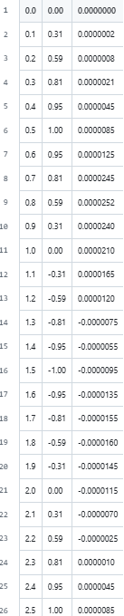
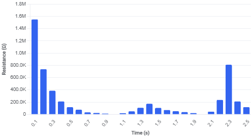

# Mycelium-Test
for back up

## Time|Voltage|Current Chart

  

## Resistance Graph

  

- Environment: Java (Custom data parsing & visualization PDF)
- Data Processing: Parsed raw time-series voltage-current (V-I) sweep data from fungal mycelium substrates. Failed to observe 2.0-second resistance cycles but isolated anomalous non-zero lingering current at 0V crossings.
- Unresolved Inquiry: Hypothetical analysis alone could not confirm whether this anomaly was true memristive behavior, internal capacitive storage, or hardware noise.
